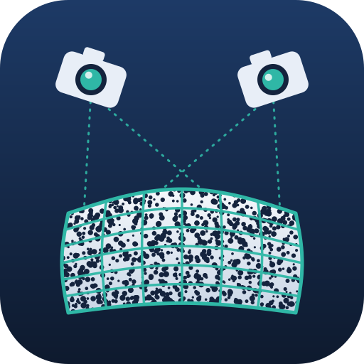

# pysdic

<p align="center">
  
</p>

[](https://pypi.org/project/pysdic/)
[](https://github.com/Artezaru/pysdic/blob/master/LICENSE)
[](https://Artezaru.github.io/pysdic)

`pysdic` measures the 3D shape and displacement field of a surface from images taken by several cameras with
**Stereo Digital Image Correlation (SDIC)**. The surface is described by a finite element mesh. The displacements
of the vertices and the camera models are estimated together, directly from the gray levels of the images.

The displacement `U` of the mesh is found by minimizing the gray level differences between the views of a
reference frame and the views of a deformed frame, at the integration points `x` of the mesh:

```
min_U  Σ_pairs Σ_x  ρ( f( P_a(x) ) - g( P_b(x + U(x)) ) )
```

where `P_a` and `P_b` are the projections of the two cameras of a pair, `f` and `g` are the images of the pair and
`ρ` is a (robust) loss function. The gray levels can be corrected (ZNSSD, ...) before they are compared.

## Features

- **Geometry**: point clouds, connectivities and surface meshes in 2D and 3D, integration points, adjacency,
  surface properties (normals, areas, ...) and ray casting.
- **Finite elements** (`pysdic.fem`): shape functions, interpolation of properties and finite difference operators
  on the meshes.
- **Camera models**: parametric transformations with their Jacobians, combining an extrinsic (rigid, perspective,
  planar, ...), a distortion (Zernike, ...) and an intrinsic model, which can be composed and reparametrized.
- **Computer vision**: projection of points, triangulation, distortion of images, optical flow and optimization
  of the camera parameters.
- **Imaging**: immutable images with spline interpolation and regions of interest, cameras and views, projection of
  a mesh onto the images (visibility, UV maps) and generation of synthetic speckle images.
- **SDIC**: an analysis object (mesh, views and displacements of each frame), correlation terms, temporal
  regularization and fixed parametrizations of the unknowns, solved with the Gauss-Newton solver
  [`pysolve-gn`](https://github.com/Artezaru/pysolve-gn). Displacements and camera parameters (extrinsic,
  distortion, intrinsic) can be optimized together.
- **Workflows** (`pysdic.workflows`): ready-made computations (initialisation by optical flow, quality control,
  reference shape, ...).
- **Displays**: 2D images with `matplotlib` and 3D scenes with `pyvista`.

All the computations are performed with `numpy` and `scipy` (sparse matrices) on a single core.

## Installation

```bash
pip install pysdic
```

`pysdic` requires Python 3.11 or later. Some features need optional dependencies, which are only imported when
they are used:

```bash
pip install "pysdic[pyvista]"   # 3D displays
pip install "pysdic[open3d]"    # ray casting on 3D meshes
pip install "pysdic[zernike]"   # Zernike distortion of the cameras
pip install "pysdic[all]"       # all the optional features
```

Or install the development version from GitHub:

```bash
pip install git+https://github.com/Artezaru/pysdic.git
```

The rendering of synthetic images with Blender is provided by the separate package `pysdic-blender`
(Python 3.13):

```bash
pip install pysdic-blender
```

See the [installation guide](https://Artezaru.github.io/pysdic/installation.html) for more details.

## Quick start

Measure the displacement of the frame 1 with two cameras, the frame 0 being the reference:

```python
import pysolvegn
from pysdic import Pairing, SDICCorrelationTerm, SDICUnknowns

# analysis: a pysdic.SDICAnalysis (mesh, views of each frame and camera)
# integration_points: the pysdic.IntegrationPoints of the mesh where the gray levels are compared
analysis.set_zero_displacement(0)
analysis.set_zero_displacement(1)  # Initial guess

unknowns = SDICUnknowns([1], [])  # Displacement of the frame 1, no camera parameter
pairings = [Pairing(0, 0, 1, 0), Pairing(0, 1, 1, 1), Pairing.stereo(1, 0, 1)]
correlation = SDICCorrelationTerm(analysis, unknowns, integration_points, pairings,
                                  gl_correction={"mode": "ZNSSD"})

result = pysolvegn.solve(terms=[correlation.term], p0=analysis.pack_unknowns(unknowns), max_iteration=20)
analysis.apply_unknowns(unknowns, result.parameters)  # Displacement of the frame 1 written in the analysis
```

More examples (meshes, camera projection, synthetic images, calibration of the cameras, displacement
measurement, ...) are available in the [examples gallery](https://Artezaru.github.io/pysdic/usage.html).

## Documentation

The [online documentation](https://Artezaru.github.io/pysdic) contains:

- the [installation guide](https://Artezaru.github.io/pysdic/installation.html) and the optional dependencies;
- the [API reference](https://Artezaru.github.io/pysdic/api.html) of all the classes and functions;
- the [examples gallery](https://Artezaru.github.io/pysdic/usage.html), by theme: geometry, computer vision,
  imaging, SDIC and workflows.

## Author

- Artezaru <artezaru.github@proton.me>

- **Git platform**: https://github.com/Artezaru/pysdic
- **Online documentation**: https://Artezaru.github.io/pysdic

## License

Copyright (C) 2026 Artezaru

This program is free software: you can redistribute it and/or modify
it under the terms of the GNU General Public License as published by
the Free Software Foundation, either version 3 of the License, or
(at your option) any later version.

This program is distributed in the hope that it will be useful,
but WITHOUT ANY WARRANTY; without even the implied warranty of
MERCHANTABILITY or FITNESS FOR A PARTICULAR PURPOSE.  See the
GNU General Public License for more details.

You should have received a copy of the GNU General Public License
along with this program.  If not, see <https://www.gnu.org/licenses/>.